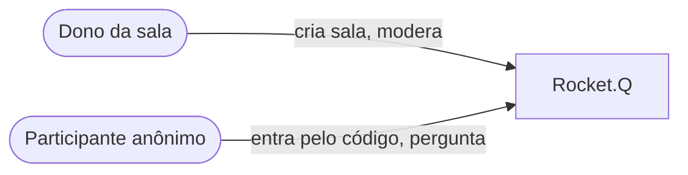
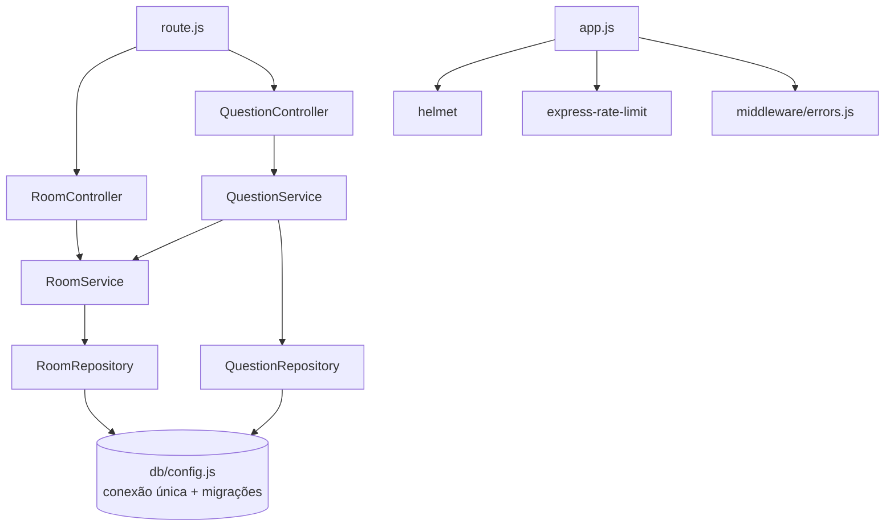
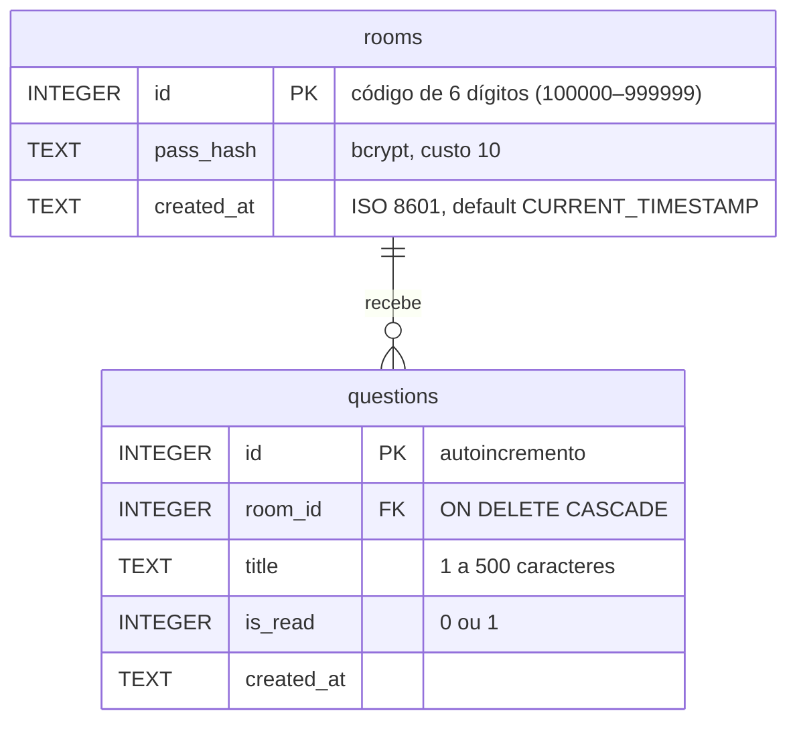

# Arquitetura alvo — Rocket.Q

## 1. Visão C4

### Nível 1 — Contexto



### Nível 2 — Contêineres

| Contêiner | Tecnologia | Responsabilidade |
|---|---|---|
| Aplicação web | Node.js 20+, Express 4, EJS (renderização no servidor) | Rotas, validação, regras de negócio e HTML |
| Banco | SQLite (arquivo) via `better-sqlite3` | Salas e perguntas |
| Hospedagem gratuita | Render (web service free) ou alwaysdata | Executa `npm start`; `DATABASE_FILE` aponta para o disco disponível |

### Nível 3 — Componentes



Camadas (Clean Architecture simplificada): **controller** só traduz HTTP ↔ serviço; **serviço** guarda as regras RN01–RN04; **repositório** é o único lugar com SQL, sempre parametrizado.

## 2. Estrutura de pastas

```
src/
├── app.js                  (novo) monta o Express; recebe o banco por injeção
├── server.js               (reescrito) lê PORT e sobe o app
├── config.js               (novo) variáveis de ambiente
├── route.js                (mantidas as mesmas URLs)
├── controllers/            (reescritos, sem SQL)
├── services/               (novo) RoomService, QuestionService
├── repositories/           (novo) RoomRepository, QuestionRepository
├── lib/                    (novo) errors.js, validation.js
├── middleware/             (novo) errors.js (404 e 500)
├── db/
│   ├── config.js           (reescrito) conexão única, WAL, foreign_keys, migrações
│   ├── migrations.js       (novo) versão do schema via PRAGMA user_version
│   └── init.js             (reescrito) CLI idempotente
└── views/                  (+ error.ejs; passincorrect.ejs sai)
tests/
└── app.test.js             (novo) node:test + supertest
```

## 3. Modelo de dados (3FN)



- **1FN:** atributos atômicos. **2FN:** chaves simples, sem dependência parcial. **3FN:** nenhum atributo depende de outro não-chave (a senha fica só na sala, nunca repetida na pergunta).
- Restrições: `NOT NULL`, `CHECK (length(title) BETWEEN 1 AND 500)`, `CHECK (is_read IN (0,1))`, `FOREIGN KEY ... ON DELETE CASCADE` com `PRAGMA foreign_keys = ON`.
- Índice `idx_questions_room_read (room_id, is_read, id)`: a página da sala vira busca por índice em vez de varredura da tabela.
- **Migração automática** (`PRAGMA user_version`): versão 0 sem tabelas → cria o schema; versão 0 com o schema antigo (`rooms.pass`, `questions.read/room`) → copia os dados para as tabelas novas, gera o hash das senhas antigas e descarta perguntas órfãs, tudo numa transação (atomicidade).

## 4. Contrato de rotas (mantidas as URLs originais)

| Método | Rota | Entrada | Sucesso | Erros |
|---|---|---|---|---|
| GET | `/` | — | 200 página inicial | — |
| GET | `/create-pass` | — | 200 formulário de senha | — |
| POST | `/create-room` | `password` (6–72) | 303 → `/room/:id?ok=sala-criada` | 400 formulário com mensagem; 429 excesso de tentativas |
| POST | `/enterroom` | `roomId` (6 dígitos) | 303 → `/room/:id` | 404 página inicial com "Sala não encontrada" |
| GET | `/room/:room` | `ok`, `erro` na query (mensagens) | 200 sala com não lidas primeiro | 404 página de erro |
| POST | `/question/create/:room` | `question` (1–500) | 303 → `/room/:id?ok=pergunta-enviada` | 303 com `erro=pergunta`; 404 sala inexistente |
| POST | `/question/:room/:question/:action` | `password`; `action` ∈ {`check`, `delete`} | 303 com `ok=marcada` ou `ok=excluida` | 303 com `erro=senha`; 404 pergunta fora da sala; 429 |

Todas as respostas levam cabeçalhos do `helmet` com CSP restrita a `'self'` e Google Fonts.

## 5. Decisões de arquitetura (ADR)

### ADR-001 — Manter Express + EJS e SQLite, trocando o driver para `better-sqlite3`

- **Contexto:** o valor do produto está no fluxo simples; reescrever em SPA não aumenta o valor do MVP. O `sqlite3` fixado no lockfile (5.0.x) baixa binários de um bucket antigo e compila com `node-gyp` quando não encontra; a instalação falhou no ambiente de verificação.
- **Decisão:** manter a renderização no servidor e as mesmas URLs; reorganizar em camadas; trocar `sqlite` + `sqlite3` por `better-sqlite3` 12 (binários pré-compilados, API síncrona, *prepared statements* reutilizáveis) e remover `node-gyp` das dependências.
- **Consequência:** funciona sem JavaScript no navegador (progressive enhancement), só o modal e o "copiar" dependem de JS. Consultas síncronas de microssegundos não bloqueiam o *event loop* de forma perceptível nesse volume.

### ADR-002 — bcryptjs para a senha da sala

- **Decisão:** `bcryptjs` (implementação pura em JS, sem compilação nativa), custo 10.
- **Consequência:** deploy sem toolchain C++; cerca de 60 ms por verificação, aceitável para uma ação humana e útil contra força bruta. Complementado por `express-rate-limit` (10 tentativas/minuto por IP nas rotas com senha).

### ADR-003 — Código da sala por `crypto.randomInt` + chave primária

- **Decisão:** sortear em `[100000, 999999]` com gerador criptográfico e deixar a `PRIMARY KEY` garantir a unicidade; em caso de `SQLITE_CONSTRAINT`, sortear de novo (até 5 vezes).
- **Consequência:** inserção O(log n) no índice da chave em vez de ler todas as salas; sem código com zero à esquerda.

### ADR-003b — Resultado das ações por redirecionamento 303 (PRG)

- **Decisão:** padrão Post/Redirect/Get com mensagens por `?ok=` / `?erro=` numa lista fechada de códigos (nunca texto livre vindo da URL, evitando injeção de conteúdo).
- **Consequência:** F5 não reenvia o formulário; a mensagem aparece em `role="status"` ou `role="alert"`.

### ADR-004 — Disco efêmero em hospedagem gratuita

- **Contexto:** o plano gratuito do Render apaga o disco a cada deploy ou reinício.
- **Decisão:** o schema é criado automaticamente na subida; `DATABASE_FILE` permite apontar para outro caminho.
- **Consequência:** as salas somem após um reinício no Render gratuito, o que é aceitável para uma ferramenta de sessão curta. Para persistir, a opção gratuita é o alwaysdata (disco persistente de 100 MB).

## 6. Fora do escopo deste ciclo

- Atualização em tempo real (WebSocket/SSE) das perguntas.
- Contas de usuário, expiração automática de salas, modo escuro (itens 3 e 4 do README).
- Migração para Express 5.
- Token CSRF: hoje toda ação sensível exige a senha no próprio formulário, o que já impede um site de terceiros de agir em nome do dono.
